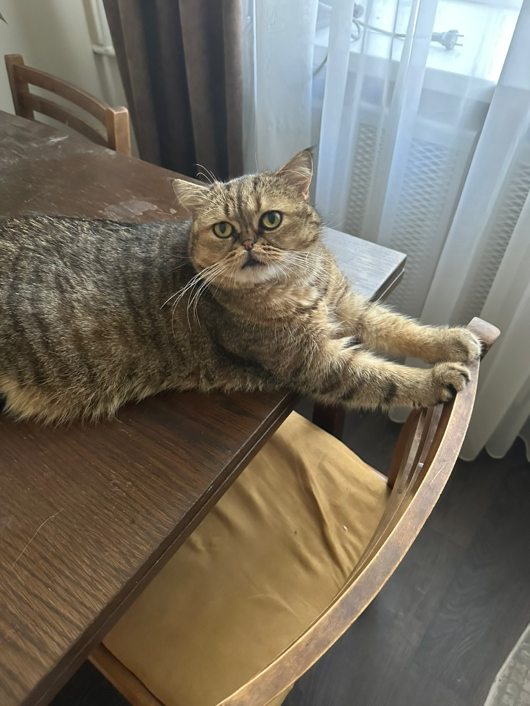

### Dmitry, software developer, *currentYear* - 2008 years old

aka **idkncc**

love photography, networking, low level programming, C/C++, Rust and Kotlin. Love exploring something new.

hate web and ai slop.

### projects

you can find em at:

- [codeberg](https://codeberg.org/idkncc)
- [gitlab](https://gitlab.com/idkncc)
- [github org](https://github.com/idkncc)
- [website](https://idkncc.dev)

### what i do

i dunno, but check out [my tg channel](https://t.me/idknccbio)

### donations

_money will go to the cat's wallet, so donate really big sums for him_

| Name     | Wallet                                                                                            |
|----------|---------------------------------------------------------------------------------------------------|
| Monero   | `49EoWy4ZvZY6CjrAinNshQJo78rDS8oMe7UiiWQ1XkwUH4HCwCygWjjhq8Aiv4ai774Rvry5wSeNuEVjLYrd8vyhFQqSkjc` |
| Ton      | `UQDYKorSsC_Z_zqtQUCxMs_XDygJISTPiGDVTSKr0SZ69_At`                                                |
| Bitcoin  | `bc1qcls6059kd5xpj20alhhlm2zgwy4sstgah3zjaq`                                                      |
| Eth      | `0xf5684f47883e3c927E082Fba125514c980Dbdd5C`                                                      |
| Tron     | `TGvX5SaUR75M6QL4hHW1RSotWE3YhNzYNc`                                                              |
| Litecoin | `ltc1ql7e9sztprj2xl3yaeltu0ae5gd57gkcfw654gp`                                                     |
